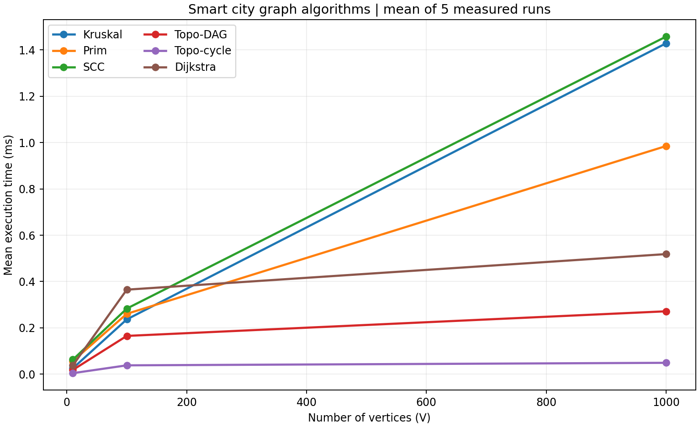

# Assignment 3 - Smart City Infrastructure and Route Planning

Daniyal Akylbek | SE-2530 | Java 17

## Overview

This console application represents city districts as numbered vertices and roads as weighted edges.
Undirected roads are used for infrastructure planning and route distances. Directed edges model
one-way connections and service dependencies. All required algorithms are implemented directly;
Java collections are used for lists, queues, stacks and binary heaps.

The graph uses an adjacency list and a separate edge list. Each undirected edge is stored once in
the edge list and twice in the adjacency lists. Vertices are numbered from 0 to V-1. A graph must
have at least one vertex. The graph class allows parallel edges and self-loops, while experimental
graphs contain neither. Edge weights are integers; total weights and distances use long.

## Run the project

Install a **JDK 17 or later**, not only a JRE. Run these commands in the project folder:

```text
javac --release 17 -d out @sources.txt
java -cp out Main
java -cp out Tests
java -cp out Benchmark
```

The same commands work in PowerShell, Command Prompt, Linux and macOS. In PowerShell keep
`@sources.txt` quoted if PowerShell interprets it: `javac --release 17 -d out "@sources.txt"`.
`Main` accepts a source district: `java -cp out Main 3`. The default source is 0.
Alternatively, run `run.bat` on Windows or `bash run.sh` on Linux/macOS. In IntelliJ, open this
folder, select JDK 17+, mark `src` as Sources Root, and run Main, Tests or Benchmark. Set the
working directory to the project root so results are written to the correct folder.
## Implementation

| File | Responsibility |
| --- | --- |
| src/graph/Graph.java | Adjacency lists, edge list and vertex validation |
| src/graph/Edge.java | An edge with from, to and weight fields |
| src/graph/Stats.java | Operation counters for one execution |
| src/graph/GraphGenerator.java | Fixed-seed graphs with exact V and E |
| src/dsu/DSU.java | Disjoint sets, path compression and union by rank |
| src/mst/MST.java | Kruskal and lazy priority-queue Prim |
| src/connectivity/Connectivity.java | Kahn topological ordering and iterative Kosaraju SCC |
| src/shortestpath/Dijkstra.java | Lazy priority-queue shortest paths and path reconstruction |
| src/Main.java | Small city demonstration with selectable source |
| src/Tests.java | Deterministic cases and independent correctness oracles |
| src/Benchmark.java | Warmup, five timed runs, operation counts and CSV output |

**Kruskal:** copy and sort all edges by weight. For each edge, union its endpoint sets. Add the
edge only when union succeeds, so a cycle is never added. Stop after V-1 selected edges.
If fewer edges are selected, report disconnected and return a minimum spanning forest.

**DSU:** find first follows parent pointers to the root, then compresses the whole visited path.
Union attaches the lower-rank root below the higher-rank root. Equal ranks cause one rank to grow.
Rank is an upper bound on tree height after compression, not the current height.

**Prim:** start at an unvisited vertex and add its frontier edges to a binary heap. Remove the
cheapest edge; skip it if its destination was already visited. Otherwise select it and add the new
frontier. Restart for every disconnected component. More than one start means no spanning tree
exists for the whole graph, although the resulting forest is still minimum-cost.

**Topological ordering:** Kahn's algorithm counts indegrees and queues all zero-indegree vertices.
Removing a vertex reduces its neighbors' indegrees. If fewer than V vertices are processed, a cycle
exists. In this case the result contains dag=false and an empty order, not a misleading partial order.

**SCC:** Kosaraju first computes DFS finishing order, then constructs a graph with every edge
reversed. DFS on the reversed graph in reverse finishing order produces the SCCs. Explicit stacks
avoid recursive call-stack limits. The first pass stores neighbor iterators to preserve finishing order.

**Dijkstra:** initialize the selected source to zero and other distances to infinity. A heap returns
the next smallest tentative distance. Relax outgoing edges and store predecessors. Improved distances
create new heap entries; outdated entries are skipped. Following predecessors backwards reconstructs
a path. An unreachable vertex has Long.MAX_VALUE distance and an empty path; the source path is [source].

Dijkstra rejects every negative-weight edge before starting. Its greedy correctness argument depends
on non-negative weights: a later route cannot lower an already finalized minimum distance. For example,
0->1 (2), 0->2 (5), 2->1 (-10) would invalidate finalizing vertex 1 at distance 2. Bellman-Ford is
appropriate when negative edges are allowed, provided reachable negative cycles are handled. The
lazy variant used here must not be relied on for negative inputs either: its stated guarantees fail.

## Complexity Analysis

Space below means auxiliary working space, excluding the input graph but including returned results.
The graph itself occupies O(V+E). Binary heaps and adjacency lists are assumed.

| Algorithm | Time | Auxiliary space | Explanation |
| --- | --- | --- | --- |
| DSU initialization | O(V) | O(V) | Parent and rank arrays |
| DSU find / union | O(alpha(V)) amortized per operation | O(1) per call | Iterative compression and rank; individual operation can be O(log V) |
| Kruskal | O(V + E log(E+1)) | O(V+E) | Sort copied edges; DSU work O(E alpha(V)); sorting dominates |
| Lazy Prim | O(V + E log(E+1)) | O(V+E) | At most E frontier entries; each inserted and removed once |
| Kosaraju SCC | O(V+E) | O(V+E) | Two traversals and a reversed graph |
| Kahn topological ordering | O(V+E) | O(V) | Count indegrees, queue vertices and examine outgoing edges |
| Lazy Dijkstra | O(V + E log(E+1)) | O(V+E) | Validation scans E; at most O(E) successful relaxations/heap entries |

For simple connected graphs, log E is O(log V), so Prim and Dijkstra have the familiar
O((V+E) log V) bound. This implementation does not use decrease-key: stale heap entries mean the
heap may occupy O(E), not only O(V). Reconstructing one shortest path costs O(V) in the worst case;
printing paths to every vertex can cost O(V^2), which is excluded from benchmark timings.

Without DSU optimizations, badly shaped parent chains can make find O(V). Rank keeps trees shallow;
compression flattens frequently accessed paths. Across a sequence of operations the amortized bound
becomes O(alpha(V)), where inverse Ackermann grows extremely slowly. The benchmark records root-search
parent steps; compression writes are not included in that counter. No separate unoptimized DSU timing
is claimed.

More edges increase sorting, scanning and heap work. More vertices increase state arrays and traversal
work. SCC and topological ordering grow linearly with V+E; heap-based methods also pay a logarithmic
factor. Disconnected inputs still incur initialization and validation work even when few edges exist.

## Experimental Setup

| Configuration | V | E |
| --- | --- | --- |
| Small | 10 | 30 |
| Medium | 100 | 500 |
| Large | 1000 | 5000 |

Each graph uses java.util.Random with seed **2530 + V** and weights uniformly sampled from 1 to 100.
Duplicate weights are intentional; duplicate endpoint pairs and self-loops are excluded.

- Undirected: first connect each vertex v>0 to a randomly selected earlier vertex. This creates a
  spanning tree. Add random unused endpoint pairs until exactly E edges exist. Kruskal, Prim and
  Dijkstra use this same graph; Dijkstra starts at district 0.
- DAG: use the same increasing-endpoint tree and only add edges from a smaller ID to a larger ID.
  Therefore cycles are impossible. Kahn is run on these graphs.
- Cyclic directed: first create a directed ring through all vertices, then add random distinct
  directed edges until E is reached. The ring guarantees a cycle and one SCC containing all vertices.
  Kosaraju and the cyclic topological experiment use these graphs. Multiple SCCs are tested separately.

Generation and graph validation occur outside the measured section. Every algorithm/size pair has
10 unmeasured warmup executions followed by exactly 5 measured executions of the same graph.
System.nanoTime() surrounds the algorithm call; initialization, result allocation, sorting, graph
reversal and counters inside the algorithm are included. CSV writing and console output are excluded.
The volatile result sink prevents ignoring results. Arithmetic mean = sum of elapsed nanoseconds / 5.
This is a small educational benchmark, not JMH: JIT compilation, garbage collection, fixed execution
order and shared-host scheduling can affect short measurements. Warmup is not proof of steady state.
The graph generator samples a constrained graph family, not all possible graph topologies.

Counter definitions:
- Edge examinations: Kruskal's sorted-edge loop; Prim's adjacency scans; SCC's two DFS scans plus
  reversal; topological indegree and outgoing-edge scans; Dijkstra's validation plus reachable adjacency scans.
- Comparisons: calls to the sorting or priority-queue comparator, excluding relaxation comparisons.
- Find/union calls: public DSU method calls, including redundant union attempts.
- Parent steps: root-search parent links followed in find, excluding compression writes.
- Queue operations: heap insertion/removal calls in Prim and Dijkstra; Kahn's FIFO actions are not counted.

These counters measure different work. They must not be summed as equivalent CPU instructions, and
an algorithm with fewer comparisons is not guaranteed to finish faster.

Environment details are in [environment.txt](results/tables/environment.txt).
All 90 measured runs are in [raw.csv](results/tables/raw.csv); means and counters are in
[summary.csv](results/tables/summary.csv).

## Results

| Algorithm | V | E | Mean time (ms) | Edges examined | Comparisons | Queue ops |
| --- | --- | --- | --- | --- | --- | --- |
| Kruskal | 10 | 30 | 0.025388 | 19 | 112 | 0 |
| Prim | 10 | 30 | 0.056537 | 60 | 197 | 60 |
| SCC | 10 | 30 | 0.062662 | 90 | 0 | 0 |
| Topo-DAG | 10 | 30 | 0.018372 | 60 | 0 | 0 |
| Topo-cycle | 10 | 30 | 0.004283 | 30 | 0 | 0 |
| Dijkstra | 10 | 30 | 0.037929 | 90 | 59 | 30 |
| Kruskal | 100 | 500 | 0.236551 | 231 | 3832 | 0 |
| Prim | 100 | 500 | 0.260530 | 1000 | 7622 | 1000 |
| SCC | 100 | 500 | 0.283173 | 1500 | 0 | 0 |
| Topo-DAG | 100 | 500 | 0.165159 | 1000 | 0 | 0 |
| Topo-cycle | 100 | 500 | 0.038059 | 500 | 0 | 0 |
| Dijkstra | 100 | 500 | 0.364900 | 1500 | 2124 | 370 |
| Kruskal | 1000 | 5000 | 1.428862 | 3602 | 50958 | 0 |
| Prim | 1000 | 5000 | 0.985195 | 10000 | 110998 | 10000 |
| SCC | 1000 | 5000 | 1.457949 | 15000 | 0 | 0 |
| Topo-DAG | 1000 | 5000 | 0.271493 | 10000 | 0 | 0 |
| Topo-cycle | 1000 | 5000 | 0.048954 | 5000 | 0 | 0 |
| Dijkstra | 1000 | 5000 | 0.518519 | 15000 | 35197 | 3846 |

Kruskal's DSU counters:

| V | Union calls | Find calls | Parent steps |
| --- | --- | --- | --- |
| 10 | 19 | 38 | 27 |
| 100 | 231 | 462 | 393 |
| 1000 | 3602 | 7204 | 6645 |

Correctness checks on the experimental graphs:

| V | E | Kruskal weight | Prim weight | Connected | DAG accepted | Cycle rejected | SCC count |
| --- | --- | --- | --- | --- | --- | --- | --- |
| 10 | 30 | 192 | 192 | true | true | true | 1 |
| 100 | 500 | 1313 | 1313 | true | true | true | 1 |
| 1000 | 5000 | 12669 | 12669 | true | true | true | 1 |




Both plots show the same three configurations against different x axes. V and E change together,
so these plots cannot isolate the independent effect of graph density.

## Comparison and Discussion

- V=10: Kruskal took 0.025388 ms and Prim took 0.056537 ms; Kruskal was faster in this recorded run.
- V=100: Kruskal took 0.236551 ms and Prim took 0.260530 ms; Kruskal was faster in this recorded run.
- V=1000: Kruskal took 1.428862 ms and Prim took 0.985195 ms; Prim was faster in this recorded run.

Kruskal sorts all E edges even when it stops selecting early. Prim scans 2E adjacency entries on
these undirected graphs and processes the heap frontier, including obsolete edges. On the largest
graph Prim makes more comparator calls, but these counters alone do not predict elapsed time.
Both methods return identical MST weights, although tied weights can allow different valid trees.

SCC time grows from 0.062662 ms at V=10 to 1.457949 ms at V=1000.
Its edge-examination count is exactly 3E: 90, 1500 and 15000. This matches the linear traversal
structure, but measured times do not scale exactly because fixed overhead and JVM behavior also matter.

Topological ordering on a DAG examines 2E edges. The ring-based cyclic graphs give every vertex at
least one incoming edge, so the initial queue is empty. They examine E edges to count indegrees and
then immediately report a cycle. This explains their lower measured time; it does not imply that all
cyclic graphs are cheaper than DAGs.

Dijkstra time changes from 0.037929 ms to 0.518519 ms.
It examines 3E edges here: E during negative-weight validation and 2E because all vertices of the
undirected graph are reachable. Heap comparisons depend on successful relaxations and stale entries,
not only on V and E. The observed operation counts show increased work as graphs grow, while the
short timings should not be treated as universal performance rankings.

## Testing

Run java -cp out Tests. The included run passed **22,182 correctness checks**.
These are assertions inside test loops, not 22,182 independently designed test scenarios.
The saved output is [tests.txt](results/tables/tests.txt).

| Case | Expected behavior |
| --- | --- |
| Known four-vertex weighted graph | Both MST weights equal 6 |
| Equal-weight cycle | Multiple valid MSTs; both weights equal 3 |
| Disconnected graph with isolated district | Both return forest weight 6 and connected=false |
| Single vertex | MST weight 0; source distance 0; one SCC; valid topological order |
| Directed self-loop | Topological cycle detected; valid one-vertex SCC |
| Several SCCs and an isolated vertex | Three SCCs; exact partition checked |
| Non-negative routes including zero weights | Distances and reconstructed paths match oracle |
| Unreachable districts | Infinite distance and empty path |
| Negative edge | Dijkstra throws IllegalArgumentException |
| Wrong graph type | Directed MST and undirected topological calls rejected |
| 20 fixed seeds, three graph types | MST agreement, DAG validity, cycle detection and reproducibility |

SCCs are checked against an independent transitive-closure oracle: vertices share an SCC exactly
when they are mutually reachable. Every vertex must occur exactly once. Shortest distances from
every source in the small graphs are compared with Bellman-Ford; reconstructed paths are checked
for real edges, correct endpoints and total weight. Topological ordering is checked against every
edge. Returned MST edges must be acyclic and connected trees must contain V-1 edges. Known examples
provide expected MST weights; random tests additionally compare the two independent MST algorithms.
The benchmark also validates MST agreement, connectivity, DAG/cycle detection and SCC count for all
three required sizes before timing.

## Conclusion

Use an MST when the task is to connect every district at minimum total construction cost. Kruskal
fits a readily available edge list; Prim naturally uses adjacency lists. Neither computes shortest
routes from a source. Use Dijkstra for non-negative travel distances, topological ordering for
acyclic service dependencies, and SCCs to identify mutually reachable regions in directed networks.
Optimized DSU makes Kruskal's cycle checks efficient. The best choice depends on the task and graph
representation; this small benchmark does not establish one algorithm as universally fastest.